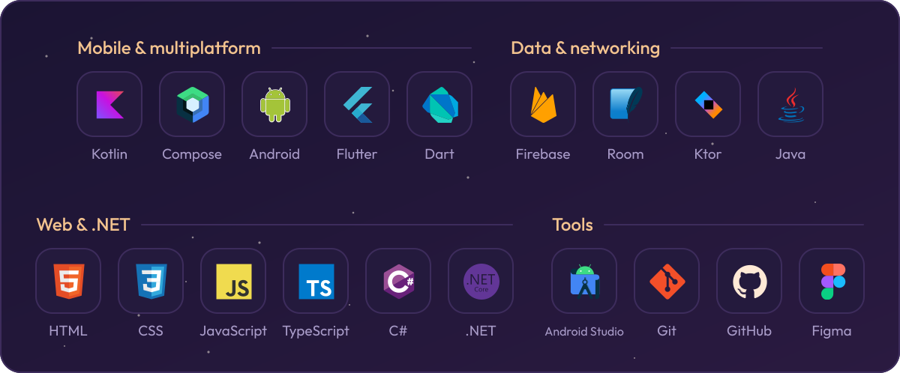
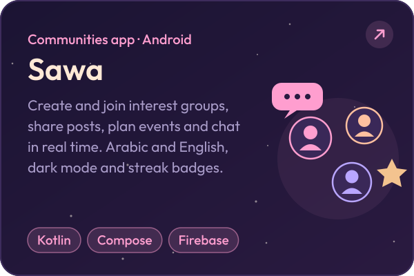
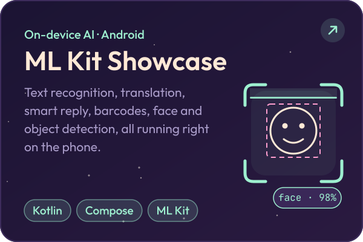

 

### ✦ hi, i'm Renad

I'm a computer science graduate from Riyadh who builds mobile apps that feel calm, clear and easy to use. Most days you'll find me in **Kotlin & Jetpack Compose**. Lately I've been building with **Flutter** and learning **full-stack web**.

- 📱 building real apps, from community platforms to money tools
- 🧠 curious about on-device AI, automation and clean architecture
- 🌍 every app I ship speaks **Arabic and English**
- ☕ fun fact: coffee and clean code can fix almost anything

 

### ✦ things i build with

### ✦ featured projects

  
  
  
  

### ✦ my contribution garden

<picture>
  <source media="(prefers-color-scheme: dark)" srcset="https://raw.githubusercontent.com/R-1102/R-1102/output/github-snake-dark.svg"/>
  <source media="(prefers-color-scheme: light)" srcset="https://raw.githubusercontent.com/R-1102/R-1102/output/github-snake.svg"/>
  
</picture>

### ✦ a line i live by

> *"First, solve the problem. Then, write the code."* — John Johnson

### ✦ let's connect

  
  &nbsp;
  

