<picture>
  <source media="(max-width: 600px) and (prefers-color-scheme: dark)" srcset="assets/header/header-narrow-dark.svg"/>
  <source media="(max-width: 600px)" srcset="assets/header/header-narrow-light.svg"/>
  <source media="(prefers-color-scheme: dark)" srcset="assets/header/header-wide-dark.svg"/>
  
</picture>

 

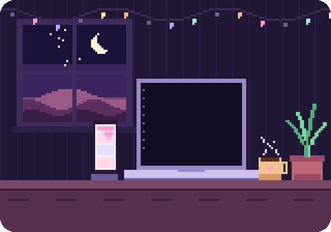

### ✦ Hi, I'm Renad

I'm a Software Engineer and Computer Science graduate from Taibah University who likes software that is clear, maintainable and built to grow.

As an Application Developer at a tech company, I build Android features with Kotlin and Jetpack Compose, develop reusable components, explore cross-platform architecture with Kotlin Multiplatform, and integrate on-device AI into mobile apps.

I'm now growing toward full-stack and backend engineering, learning C#, .NET and modern web development through Microsoft's Full-Stack Developer Professional Certificate.

I enjoy untangling problems, trying new tools and improving a little every day, usually with a cup of coffee nearby.

**Based in** Madinah, Saudi Arabia · **Languages** Arabic (native), English

 


### ✦ Experience

<picture>
  <source media="(max-width: 600px) and (prefers-color-scheme: dark)" srcset="assets/sections/experience-narrow-dark.svg"/>
  <source media="(max-width: 600px)" srcset="assets/sections/experience-narrow-light.svg"/>
  <source media="(prefers-color-scheme: dark)" srcset="assets/sections/experience-wide-dark.svg"/>
  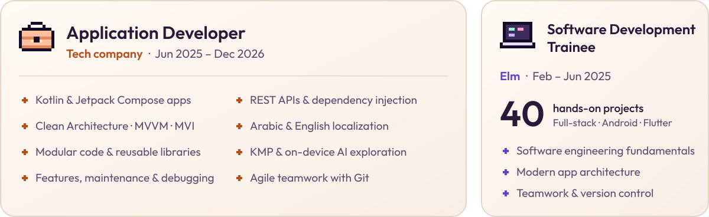
</picture>

### ✦ Skills

<picture>
  <source media="(max-width: 600px) and (prefers-color-scheme: dark)" srcset="assets/sections/stack-narrow-dark.svg"/>
  <source media="(max-width: 600px)" srcset="assets/sections/stack-narrow-light.svg"/>
  <source media="(prefers-color-scheme: dark)" srcset="assets/sections/stack-wide-dark.svg"/>
  
</picture>

### ✦ Featured projects

  <a href="https://github.com/R-1102/SawaApplication">
  <picture>
    <source media="(max-width: 600px) and (prefers-color-scheme: dark)" srcset="assets/projects/01-sawa-narrow-dark.svg"/>
    <source media="(max-width: 600px)" srcset="assets/projects/01-sawa-narrow-light.svg"/>
    <source media="(prefers-color-scheme: dark)" srcset="assets/projects/01-sawa-dark.svg"/>
    
  </picture>
  </a>
  <a href="https://github.com/R-1102/core-location">
  <picture>
    <source media="(max-width: 600px) and (prefers-color-scheme: dark)" srcset="assets/projects/02-core-location-narrow-dark.svg"/>
    <source media="(max-width: 600px)" srcset="assets/projects/02-core-location-narrow-light.svg"/>
    <source media="(prefers-color-scheme: dark)" srcset="assets/projects/02-core-location-dark.svg"/>
    
  </picture>
  </a>

  <a href="https://github.com/R-1102/microsoft-fullstack-coursera">
  <picture>
    <source media="(max-width: 600px) and (prefers-color-scheme: dark)" srcset="assets/projects/03-microsoft-fullstack-narrow-dark.svg"/>
    <source media="(max-width: 600px)" srcset="assets/projects/03-microsoft-fullstack-narrow-light.svg"/>
    <source media="(prefers-color-scheme: dark)" srcset="assets/projects/03-microsoft-fullstack-dark.svg"/>
    
  </picture>
  </a>
  <a href="https://github.com/R-1102/android-mlkit-showcase">
  <picture>
    <source media="(max-width: 600px) and (prefers-color-scheme: dark)" srcset="assets/projects/04-mlkit-showcase-narrow-dark.svg"/>
    <source media="(max-width: 600px)" srcset="assets/projects/04-mlkit-showcase-narrow-light.svg"/>
    <source media="(prefers-color-scheme: dark)" srcset="assets/projects/04-mlkit-showcase-dark.svg"/>
    
  </picture>
  </a>

  <a href="https://github.com/R-1102/ai-fitness-tracke">
  <picture>
    <source media="(max-width: 600px) and (prefers-color-scheme: dark)" srcset="assets/projects/05-ai-fitness-tracker-narrow-dark.svg"/>
    <source media="(max-width: 600px)" srcset="assets/projects/05-ai-fitness-tracker-narrow-light.svg"/>
    <source media="(prefers-color-scheme: dark)" srcset="assets/projects/05-ai-fitness-tracker-dark.svg"/>
    
  </picture>
  </a>
  <a href="https://github.com/R-1102/elm-fullstack-bootcamp">
  <picture>
    <source media="(max-width: 600px) and (prefers-color-scheme: dark)" srcset="assets/projects/06-elm-fullstack-narrow-dark.svg"/>
    <source media="(max-width: 600px)" srcset="assets/projects/06-elm-fullstack-narrow-light.svg"/>
    <source media="(prefers-color-scheme: dark)" srcset="assets/projects/06-elm-fullstack-dark.svg"/>
    
  </picture>
  </a>

### ✦ Journey

<picture>
  <source media="(max-width: 600px) and (prefers-color-scheme: dark)" srcset="assets/sections/journey-narrow-dark.svg"/>
  <source media="(max-width: 600px)" srcset="assets/sections/journey-narrow-light.svg"/>
  <source media="(prefers-color-scheme: dark)" srcset="assets/sections/journey-wide-dark.svg"/>
  
</picture>

  <a href="https://github.com/R-1102/elm-fullstack-bootcamp">Elm Full-Stack</a> ·
  <a href="https://github.com/R-1102/elm-android-bootcamp">Elm Android</a> ·
  <a href="https://github.com/R-1102/elm-flutter-bootcamp">Elm Flutter</a> ·
  <a href="https://github.com/R-1102/microsoft-fullstack-coursera">Microsoft Full-Stack</a>

### ✦ Also on my GitHub

- [**elm-android-bootcamp**](https://github.com/R-1102/elm-android-bootcamp): 21 Android projects from Elm's bootcamp, from Kotlin basics to MVI, Room, Hilt and Firebase.
- [**elm-flutter-bootcamp**](https://github.com/R-1102/elm-flutter-bootcamp): five Flutter projects covering GetX, REST APIs with Dio, SQLite and local notifications.
- [**android-order-management-module**](https://github.com/R-1102/android-order-management-module): a delivery-orders feature module from a team project (Compose, Clean Architecture, maps).
- [**kmp-delivery-management**](https://github.com/R-1102/kmp-delivery-management): a team proof of concept moving a delivery app to Kotlin Multiplatform.
- [**MyRiyal**](https://github.com/R-1102/MyRiyal): a personal expense tracker with offline support, charts and budget alerts.

### ✦ Contribution garden

<picture>
  <source media="(prefers-color-scheme: dark)" srcset="https://raw.githubusercontent.com/R-1102/R-1102/output/github-snake-dark.svg"/>
  
</picture>

<em>"First, solve the problem. Then, write the code."</em> — John Johnson

  <a href="https://www.linkedin.com/in/renad-alhazmi-764b49321"><picture><source media="(prefers-color-scheme: dark)" srcset="assets/ui/btn-linkedin-dark.svg"/></picture></a>
  <a href="https://github.com/R-1102"><picture><source media="(prefers-color-scheme: dark)" srcset="assets/ui/btn-github-dark.svg"/></picture></a>
  <a href="https://github.com/R-1102?tab=repositories"><picture><source media="(prefers-color-scheme: dark)" srcset="assets/ui/btn-repos-dark.svg"/></picture></a>

<picture>
  <source media="(max-width: 600px) and (prefers-color-scheme: dark)" srcset="assets/sections/footer-narrow-dark.svg"/>
  <source media="(max-width: 600px)" srcset="assets/sections/footer-narrow-light.svg"/>
  <source media="(prefers-color-scheme: dark)" srcset="assets/sections/footer-wide-dark.svg"/>
  
</picture>
