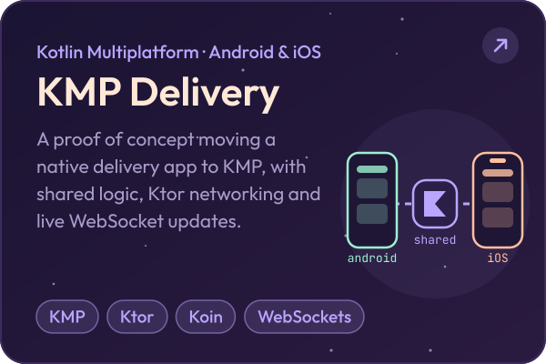
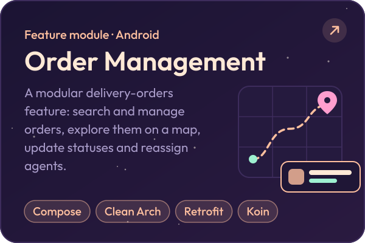
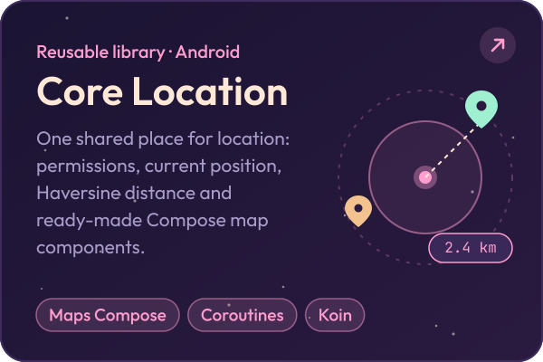
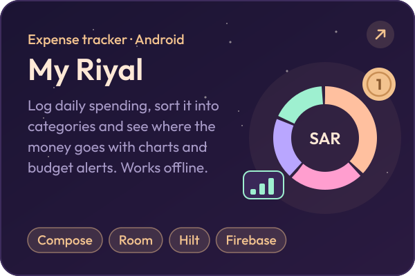

 

### ✦ hi, i'm Renad

I'm an Android developer and computer science graduate from Riyadh. I build with **Kotlin & Jetpack Compose**, and I care about clean architecture and modular code that a team can grow with.

On a delivery-management team project I built a reusable location library, an order-management feature module and a **Kotlin Multiplatform** proof of concept. Right now I'm working through Microsoft's **Full-Stack Developer** certificate.

- 📱 Android first: Compose, MVVM & MVI, Clean Architecture, Koin & Hilt
- 🔁 exploring KMP to share code between Android and iOS
- 🧠 curious about on-device AI with Google ML Kit
- 🌍 every app I build speaks **Arabic and English**
- ☕ coffee and clean code can fix almost anything

 

### ✦ things i build with

### ✦ featured projects

  
  
  
  
  
  

### ✦ my learning journey

  <a href="https://github.com/R-1102/elm-fullstack-bootcamp">Full-Stack bootcamp</a> ·
  <a href="https://github.com/R-1102/elm-android-bootcamp">Android bootcamp</a> ·
  <a href="https://github.com/R-1102/elm-flutter-bootcamp">Flutter bootcamp</a> ·
  <a href="https://github.com/R-1102/microsoft-fullstack-coursera">Microsoft Full-Stack</a>

### ✦ my contribution garden

<picture>
  <source media="(prefers-color-scheme: dark)" srcset="https://raw.githubusercontent.com/R-1102/R-1102/output/github-snake-dark.svg"/>
  <source media="(prefers-color-scheme: light)" srcset="https://raw.githubusercontent.com/R-1102/R-1102/output/github-snake.svg"/>
  
</picture>

### ✦ a line i live by

> *"First, solve the problem. Then, write the code."* — John Johnson

### ✦ let's connect

  
  &nbsp;
  

